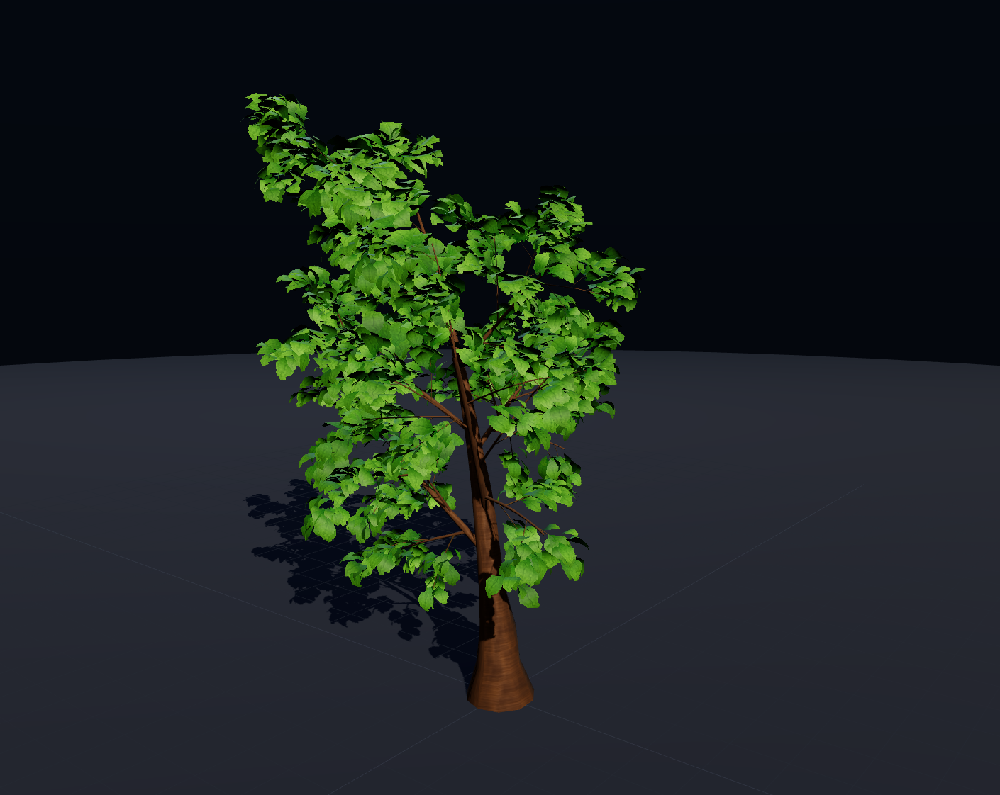
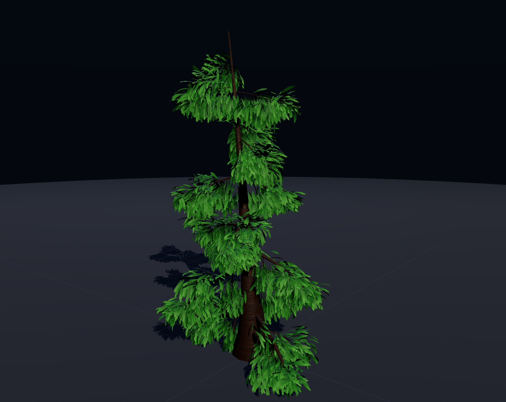
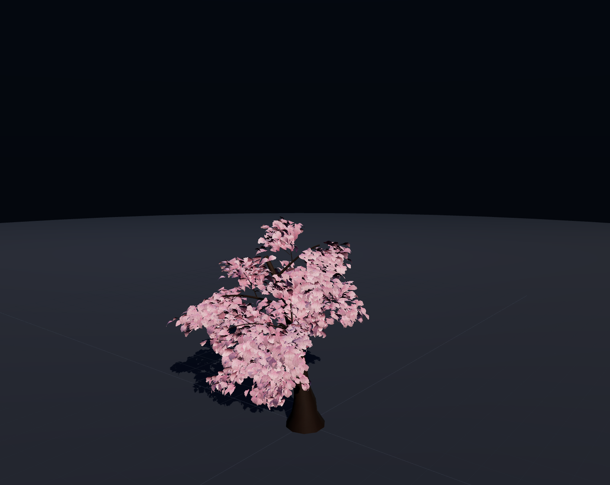
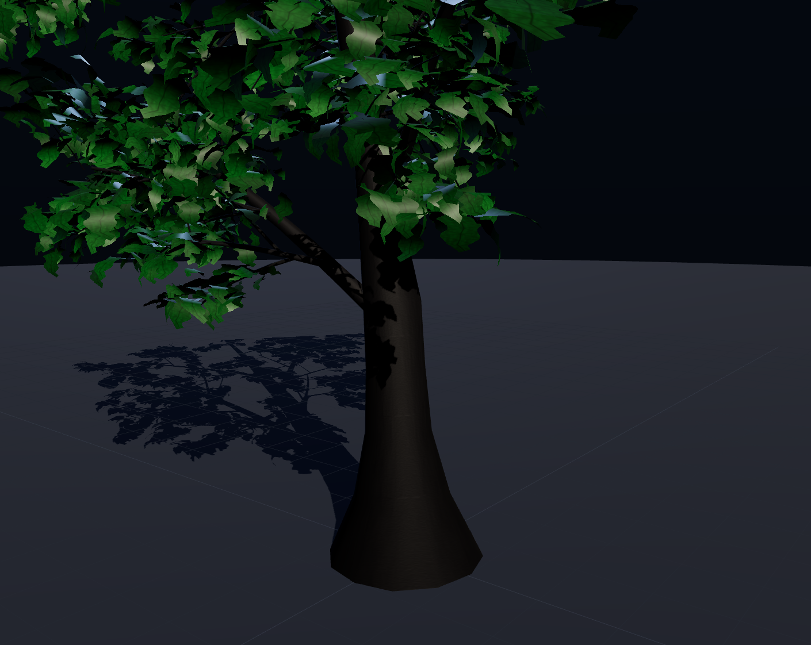
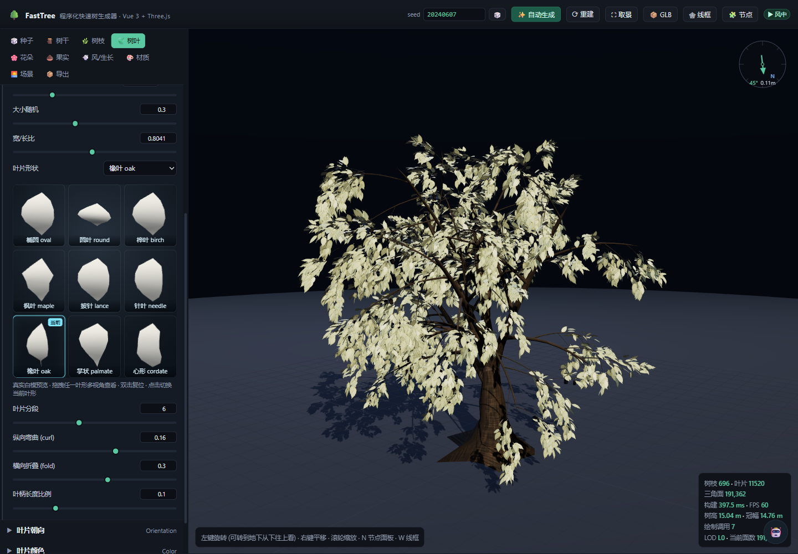

# 🌳 FastTree · 快速树生成工具

仿 **SpeedTree** 的程序化树木生成器 —— **Node + Vue 3 + Three.js**。
树干、树枝、树叶全参数可调，支持**自定义材质 / 自定义 GLSL**，**自动生成风向与风场强度**，并由**随机种子**保证完全可复现。



| 松树预设 | 樱花预设 | 自定义 GLSL 测试 |
| --- | --- | --- |
|  |  |  |

---

## 快速开始

```bash
npm install
npm run dev          # 打开 http://127.0.0.1:5273 (同时自动启动应用桥/MCP, 默认 5275)
npm run build        # 产物在 dist/
npm run preview      # 预览构建产物
npm run selftest     # 无浏览器自检 (确定性/参数隔离/几何合法性/规模预算/导出格式)
```

> `npm run dev` 已内置 Vite 的沙箱兼容入口（受限环境也不会因 `net use` 探测报 `EPERM`），
> 并会自动拉起本地应用桥 / MCP / 大模型代理；普通环境想直接用原生 vite 可用 `npm run dev:raw`。
> 桥的复用/自动升级/日志位置见「AI 对话助手」一节。

界面：左侧参数面板（8 个标签页）+ 右侧**可收起的「模型节点」面板**（顶栏 `🧩 节点` 或快捷键 `N` 开关，**默认收起**），
右侧 3D 视口（左键旋转 / 右键平移 / 滚轮缩放；**可转到地面以下从下往上看**），右上角统计与**风向指示器**，左上角选中提示条。
顶栏有 seed 输入、🎲 换种子、✨ 自动生成、⟳ 重建、⛶ 取景、📦 GLB 导出、**🕸 线框**（依次切换 关闭 / 实体+线框 / 仅线框，快捷键 `W`）、🧩 节点、风播放开关。

**鼠标 hover 任意参数名**会浮出该参数的说明（控制什么、单位、调大调小的效果）；
说明集中在 `src/core/paramDocs.js`，自检保证 **164 个面板标签 100% 有说明**（见 [10] 属性说明覆盖率）。

---

## 功能一览

### 0. 树种 · 生长阶段 · 季节 (三维预设)
三个正交维度组合出完整参数，**每个组合都可以配任意种子**：

| 维度 | 取值 |
| --- | --- |
| **树种** | 🌳 橡树 · 🌲 松树 · 🌿 白桦 · 🍃 垂柳 · 🌸 樱花 · 🪴 灌木 · 🪵 枯树（共 7 种，参考图陆续补充） |
| **生长阶段** | 🌱 树苗(当年生) → 🌿 幼树(1~3年) → 🌳 小树(3~10年) → 🌳 大树(10~60年) → 🪵 古树(60年+) |
| **季节** | 🌸 春(新芽: 叶小而稀、嫩绿透光) · ☀️ 夏(叶厚色深) · 🍂 秋(红橙黄、色差大) · ❄️ 冬(落叶 / 枯叶残留) |

组合总数 **7 × 5 × 4 = 140**；点任一维度立即重新生成，面板顶部实时显示组合名与说明。

**语义保证**（都有自检断言，见 `[11]`）：

- 换**季节** = 同一棵树换物候：树皮几何逐字节不变，只改叶色 / 叶片数量 / 透光 / 树皮色调
- 换**生长阶段** = 同一棵树长大：主干高度与整树高度均值严格递增，枝量 / 层级 / 叶片同步增长
- 换**种子** = 同一个种群里的不同个体（形态、大小、枝角、树冠开张度都会变）
- **常绿树种**（松树）冬季不落叶；**樱花**春季满树粉花而非绿叶；橡树冬季保留枯叶（marcescence）

### 0.1 橡树（按 8 张参考图重做）
- **主干低分叉**：约 1/3 高度处分成 2~4 条主枝（新增 `主干分叉` 参数组：主枝数/高度/夹角/半径比/长度/锥度/弯曲/重力）
  —— 这是参考图里最显著的特征（图 4/6/8 都是低分叉）
- **主干粗而短**：`底半径 0.56m / 高 11.5m`，根部外扩 1.6、节瘤 4、gnarl 0.8、twist 0.12
- **树冠比高度宽**：成熟个体 宽/高 ≈ 0.8~1.3，古树 1.0~1.4（活橡树那种开张感）
- **低位大枝**：L1 粗（半径比 0.5）且长（0.6 倍树高）、俯仰 66°、先外展后平伸（upBias + 重力 + 弯曲）
- **末梢细枝密、叶片成簇挂在枝梢**：4 级枝条，叶片只长在 L3/L4/L5，`startT 0.42` 起
- **羽状裂叶**（用 maple 轮廓近似）+ 秋色红橙 + 冬季枯叶残留
- 同一树种配不同种子能长出"直立型"与"开张型"（参考图 6 vs 图 4）

### 1. 树干 (Trunk)
高度、底部半径、锥度、锥度曲线、纵向/周向分段、弯曲、弯曲随机、倾斜与倾斜方向、扭转、不规则生长 (gnarl)、椭圆截面；
根部外扩 (flare) 与外扩高度、**节瘤 (knots)** 数量/大小/整体强度/纵向跨度/角向跨度；
**树干树枝树根一体建模**开关：树皮管线可切换，默认 **SpeedTree 分枝管 + 领口**；旧 **skin 管线**把树干/树枝/树根建成**同一张连续 2-manifold 蒙皮** —— 先建骨架图（骨架节点/边/半径/父子关系）→ 在骨架节点处生成截面环 → 沿骨架边扫掠蒙皮 → 分叉节点用显式环桥接缝合（父枝在分叉高度局部加密截面环，使切口高度≈子枝直径；窗口放不下时先收窄窗口，而不是把窗口挪到别的环带；子枝/树根基部落在父枝 flare/knots 调制后的**真实表面**上，且贴附方位跟随枝条真实生长方位；子枝第 0 圈 30% 贴父枝表面、70% 自身方向，前两圈过渡）→ 根部/枝梢端盖收口；每圈额外复制一个接缝顶点让 UV 连续（渲染上是 UV 缝，拓扑校验按缝对焊接后仍要求 boundary=0/nonManifold=0/components=1）；没有分支丢弃、没有最大连通分量过滤、没有 SDF、也没有"每根枝条单独建管再做并集"。最终校验：边界边 = 0、非流形边 = 0、非流形顶点 = 0、连通分量 = 1、每条骨架分支都有蒙皮、且没有未桥接的子分支 (`failedWindows = 0`)。`一体建模 (onePiece)` 本身只控制两件事：① 导出时把树干/树枝/树根合并为单个 `Bark` mesh；② 给子分支与树根基部加少量领口外扩（更融合）。关闭时只是导出保留 `Bark_Trunk/Branch/Roots` 节点拆分，拓扑不变。

**分叉开口对中 / 根部圆度**：父枝在子枝贴合高度的局部加密带会移除夹在中间的原始骨架帧，使窗口环带中心与子枝 ring0 轴向对齐；ring0 法线在父枝表面法线与自身方向之间取 70% 自身方向，粗枝根部短/长轴 ≥0.91（不再是贴平洞口造成的“瘪掉”）。

**树枝窗口错开 / 洞口细化**：分叉主枝会按相邻 L1 枝的窗口高度错开起始高度；窗口 rim 与子枝 ring0 之间插入一圈中间领口环，把跨洞口的大斜三角细分为两层。橡树粗枝窗口 rim 最小间距从 0.033 m 级提升到 **0.256 m**。

### 树皮几何管线（两套，可切换）

「材质 → 树皮材质 → 树皮管线」：

- **SpeedTree 分枝管 + 领口（默认）**：每根骨架分支是一根独立闭合管，基部向父枝内部延伸并带一圈外扩领口，**不在父枝上开窗**。没有“窗口中心 vs 枝心”的量化偏移，也没有桥接斜鳍；代价是整张树皮由多个闭合分量组成（`components = 骨架分支数`），壳体之间是几何重叠而不是布尔并集。
- **单张连续蒙皮（旧，可切回）**：骨架 → 环带 → 显式窗口 + zipper；单连通、水密、UV 缝焊接后 boundary=0。旧代码原样保留。

SpeedTree 模式的验收是：`boundary=0 / nonManifold=0 / nonManifoldVertices=0 / components=分支数 / 所有骨架分支有蒙皮 / failedWindows=0`；它**不是**单连通水密体，不适合 3D 打印/布尔，但适合实时树 + 领口遮缝。

**单枝编辑**：模型节点树选中一根树干/树枝/树根，在「单枝编辑」里单独调半径倍率、XYZ 移动、XYZ 旋转和扭曲；子枝、叶片、果实、窗口/领口会跟随。编辑按骨架分支下标保存，换 seed/随机树/预设会清空。

**单枝 3D 变换轴**：选中枝条后可在枝基显示 Blender 风格 XYZ 轴：切换「移动 / 旋转」与「世界 / 局部」坐标空间，直接拖 X/Y/Z 箭头或旋转环；拖动时实时重建，松开鼠标结束。滑杆仍可连续调。

**叶/花光照与落物**：树叶自发光/反光/散光正反面都生效；花朵有独立的同组材质参数；落叶、落叶堆、落花、落花堆默认继承对应叶/花材质光照，可在面板用 checkbox 关闭。

**自发光正反面一致**：three 的 `emissive` 原本加进 `outgoingLight` 后再统一 tone mapping —— 正面叶片被阳光照得很亮时，这份加法会被 ACES 压掉，只有背光/树下的一面看得见（表现为"自发光仅背面生效"）。现在物理项清零、自发光改到 `colorspace_fragment` 之后按**显示空间**合成（色相混合 + 显示空间加法），同一个强度值在正面/背面观感一致（实测正/背面像素变化比值从 0.73 提升到 0.96（半强度 1.00））。材质的 `emissive` 仍照常写入，导出的 GLB 不受影响。

**材质球**：树叶材质球在「树叶」页，花朵材质球在「花朵」页，「材质」页只保留树皮材质球。

**子枝半径约束**：生成蒙皮前逐级检查，任意子枝基部半径 ≤ 父枝贴合处半径的 **80%**（L1 收细后 L2/L3 继续按新父半径约束）；只缩放半径，不改位置/贴合点。统计见 `skin.stats.radiusClamp`。

**树枝环绕式叶/花**：叶片/花朵面板新增「树枝环绕生长」，沿每根枝条的轴向按指定圈数螺旋分布叶簇或花朵；只作用于树枝，不再支持树干环绕。

**扭转变形跟随**：主干/树枝的 `twist` 与 5 点扭曲曲线会旋转贴附点与生长方向；子枝、分叉主枝、树根都跟随（不是只转截面）。顶栏「骨架」按钮（快捷键 K）显示骨架节点/边叠加层。

实现细节、缺陷根因与修复记录见 [树皮骨架与单蒙皮技术文档](docs/树皮骨架与单蒙皮-技术文档.md)。

### 2. 树根 (Roots)
数量、长度、长度随机、半径比、辐射范围、与树干夹角、弯曲、下扎强度、分段、**上下偏移**、**自动错位开窗**。

树根窗口错位：`自动错位开窗` 会按方位冲突把相互重叠的根分到不同高度（相邻序号至少错开一层），避免两个粗根窗口挤在同一处；`上下偏移` 可整组上下移动根系。橡树预设的根窗口 rim 最小间距从 **0.014 m** 提升到 **0.318 m**（回归断言 >0.1 m）。

### 3. 树枝 (Branches) —— 5 级层级，每级独立参数
- **分布**：每根父枝上的数量、起始/结束位置、位置抖动、叶序角 (默认 137.5° 黄金角)、方位离散
- **形态**：长度比、长度随机、半径比、半径随机、锥度、半径曲线、与父枝夹角、夹角随机、弯曲、弯曲随机、重力(负=下垂)、向上偏置、扭转、纵向/周向分段
- **交叉截面**：`round` / `star`(星形凹凸) / `square`，星形深度
- **柔度增益**：该级枝条随风摆动的权重
- **全局修正**：长度/半径倍率、重力倍率、趋光性、顶端优势 (越靠梢部枝条越短)、起始位置整体偏移

### 4. 树叶 (Foliage)
启用开关、长在哪几层枝条、每条枝条叶簇位置数、每簇叶片数、叶簇半径与离散；
叶片长度/大小随机/宽长比、**9 种叶形** (椭圆/圆叶/桦叶/枫叶/披针/针叶/橡叶/掌状/心形)、分段、纵向弯曲 curl、横向折叠 fold、叶柄长度；
叶形下拉框下方是 **9 个真实白模预览**（程序化叶形几何 + 白色 PBR 材质，不是贴图缩略图）：拖拽任一格子可独立旋转查看多视角、双击复位，点击格子即切换当前叶形，并实时跟随分段/curl/fold/宽长比参数。9 个白模共用 **1 个 WebGL canvas**（setScissor/setViewport 分格渲染），不会触发浏览器的 WebGL context 上限；


朝向：相对枝条俯仰、俯仰随机、自重下垂、叶面朝上、滚转随机、叶柄扭转、对齐枝条程度；
颜色：叶基色、叶尖色、颜色随机；
LOD：树皮细节倍率、叶片保留比例、叶片数上限。
贴图卡片模式、内置叶片卡片库、树叶材质、落叶 / 落叶堆积 / 叶片粒子发射全部位于「树叶」面板；
「材质」面板只保留树皮材质与自定义 GLSL。

### 5. 风场 + 生长动画 (Wind / Growth)
- **自动风场**：勾选后由种子推导 **风向 / 强度 / 阵风 / 湍流 / 相位空间尺度 / 柔度衰减 / 叶扇动量**；也可以随时 🎲 重新随机风向风场
- **手动风场**：基础位移、摆动速度、高频分量密度、阵风强度与速度、湍流(横向)、**顺风偏置**、相位空间尺度、柔度衰减指数、树干树枝摆幅、叶片扇动、叶片铰链俯仰、时间缩放
- **生长动画**：进度 0→1（顶点着色器把枝条从基点"长出来"），可一键从 0 播放

**风量默认很轻但看得见**：`strength` 默认 0.15m ⇒ 树冠**动态**摆幅峰峰值 ≈0.125m（旧版默认是 0.315m，
上一版一度压到 0.042m 导致"看不出风向"）。自检把这条卡在两处：`[6]` 断言动态摆幅 ∈ [0.08, 0.20]，
`[6b]` 断言运动主轴跟随风向（8 个方向误差 < 5°）且水平位移占比 > 0.9。

**风向指示器**：视口右上角罗盘把世界风向**投影到相机的地面基**上，所以箭头方向就是你在画面里看到的摆动方向；
外圈蓝色 `N` 表示世界 +Z，方便对照绝对方位；正对相机时箭头会变短（投影变短 = 屏幕上本来就看不出来）。

**叶片动力学（物理约定，不绕圈）**：

| | 做法 | 为什么 |
| --- | --- | --- |
| 叶柄 | 固定不动 | 叶片长在枝上，不能整片飘走 |
| 位移 1 | 沿**固定方向**（下风向 + 重力）弯曲，幅度 ∝ 顶点到叶柄的距离 | 方向不随时间/相位旋转 ⇒ 结构上不可能画圈 |
| 位移 2 | 绕**固定水平轴**（垂直于风向）的铰链式俯仰 | 就是叶片迎风翻动，物理上真实 |
| 顺风偏置 | 位移恒偏下风向（风只推不拉） | 真实风荷载是单向的 |
| 横向分量 | 仅来自 `turbulence` 参数 | 横向阵风抖动，可控且量级明确 |

> 早期版本是"整片绕世界垂直轴自转" + 与主波不同频的横向位移，合成出来就是小椭圆 = 打转。
> 现在 `turbulence=0` 时轨迹会退化成**一条精确的直线**（自检 [6b] 断言 `thinness === 0`）。

风由 **顶点着色器实时计算**，不需要重建几何：
每根枝条带独立相位 `aPhase`，柔度 `aWind` 沿层级累积（根部≈0，梢部≈1），
所以树梢摆得比树干大。

### 6. 材质 (Materials) —— 支持自定义
> 树叶材质、双面叶片、落叶 / 落叶堆积 / 叶片粒子发射的控件都在「树叶」面板；本面板只保留树皮材质与自定义 GLSL。

- **树皮**：4 种程序化花纹（粗糙 / 白桦 / 松鳞 / 光滑）、花纹缩放与对比、双色渐变、色调 tint、粗糙度、金属度、法线强度、凹凸强度、顶点色混合、UV 横/纵向重复，**可上传自己的颜色贴图与法线贴图**
- **树叶**：色调、顶点色混合、粗糙度、金属度、**自发光强度**、Alpha 裁剪、**透光度(背光)**、双面渲染，
  **可上传带 alpha 的叶片贴图与法线贴图**；
  **贴图偏移**：树叶/花朵都支持二维拖动 U/V 偏移、横向/纵向平铺、贴图旋转，以及各自的一键复位；
  **模型旋转**：树叶/花朵可绕自身法线旋转模型（±180° 可校正贴图偏移造成的叶梗/花梗反向）；
  **双面叶片**：正面/背面可分别设置颜色与贴图（背面贴图支持 alpha，留空则沿用正面贴图仅换颜色），
  背面贴图可直接从**内置叶片贴图库**按批次/叶形选择缩略图，也可上传自定义图；片元用 `gl_FrontFacing` 切换正/背面贴图与颜色，开启后自动双面渲染；背面不参与正面季节顶点色染色
- **自定义 GLSL**：面板里直接写顶点/片元片段，注入到标准 PBR 材质中：
  - 顶点：`transformed / position / normal / uv / uTime / uSeed / aWind / aPhase / aOrigin / aGrow`
  - 片元：`diffuseColor / vTreeUv / vColor(需 .rgb) / uTime / uSeed / uTint`
  - 编译失败会在视口顶部弹出着色器日志（不是静默黑屏）

### 7. 模型节点展示 (节点树)
每次生成都会产出一棵**模型节点树**（右侧可收起面板：顶栏 `🧩 节点` / 快捷键 `N`，**默认不展示**），
用来点选、定位、检查任意部件：

- **节点粒度**：树干 · 每一条树根 · 每一根树枝 (按层级分组) · 每一簇树叶 · 两个材质节点
- **层级面板**：按组折叠 (`树干 / 树根 / 树枝 L1..L5 / 树叶 L1..L5 / 材质`)，显示每组节点数与三角面；
  展开后列出组内每个节点（树干 `L2 枝 #12` 这种带层级编号的名字），支持搜索、全部展开、全选可见
- **面板默认收起**，组也默认全部折叠；右下角视口的选中提示条上有「🧩 节点面板」按钮可随时召回，
  关闭面板不影响已选中的高亮/隔离状态
- **点选交互**：单击 = 选中并高亮，`Ctrl/Cmd + 单击` = 多选，双击 = 相机聚焦到该节点
- **三种显示方式**：
  - `高亮`：选中部分叠加高亮色 + 自发光，其余不变
  - `仅显示选中`：其余几何在片元里 `discard`（隔离查看内部结构，此时关闭 castShadow 避免残影阴影）
  - `其余变暗`：未选中部分按系数压暗，便于看清新长出的枝
- **黄色包围盒**：选中节点的世界包围盒实时画出（`Box3Helper`），工具栏「⛶ 聚焦」把相机贴上去
- **节点详情**：名称 / 类型 / 所属组 / 父节点 / 三角面 / 顶点 / 长度 / 基部半径 / 分段 / 叶片数 / 包围盒尺寸，
  并可「仅显示它」
- **选中提示条**：视口左上角显示当前选中（例如 `树枝 L2 · 35 个节点 · 高亮`）

实现要点（选择本身不增加 draw call；渲染分块见「渲染开销」）：

1. 生成阶段给每个元素一个顺序 `slot`，顶点属性 `aNodeId` 写 slot；
2. 生成结束后按"组"重排成最终 node id（**同组 id 连续**），并把顶点里的 slot 原地改写成 node id；
   顺手一趟遍历就能统计每个节点的顶点数、面数与包围盒；
3. 选中集合压缩成 ≤8 个连续区间（`selectionRanges`），以 `uniform vec2 uSelRanges[8]` 传给着色器；
4. 顶点着色器逐顶点比较 `aNodeId` 得到 `vTreeSelected`，片元里做高亮 / 隔离 / 变暗；
   材质节点没有自己的几何，改用 `uSelectMaterial` 与每个材质的 `uIsLeaf` 判定。

节点表与种子绑定：同一个 seed 生成同一套节点（自检里做了节点表一致性断言）。

### 8. 场景 / 导出
渐变天空与颜色、背景、曝光、太阳强度/方位角/高度角、环境光、阴影、地面、网格、雾、相机自动旋转；
导出 **GLB (glTF 二进制，含程序化贴图)**、**OBJ**、**参数 JSON**（载入即可复现同一棵树）、**PNG 截图**。
点击导出会先弹出**导出预览面板**：列出导出产物（GLB/OBJ/JSON/PNG）、内嵌贴图缩略图、mesh 节点列表；图片可点击放大预览，
面板底部 **取消** / **确定导出** 确认后才真正下载。
GLB 内贴图资源按 `_diff` / `_alpha` / `_nor_gl` / `_rough` 命名；贴图尺寸恰为 1K/2K/4K 时追加 `_1k`/`_2k`/`_4k`，其它尺寸不加 `_xk` 后缀。
树干、树枝、树根共享**同一张连续 2-manifold 蒙皮**：根部与枝梢用端盖收口，拓扑校验为边界边 = 0、非流形边 = 0、非流形顶点 = 0、单连通体；导出时按节点拆出的每个 `Bark_*` 节点都来自这张已闭合的蒙皮。
导出时会自动补全缺失的 normal/roughness 贴图：法线从颜色贴图亮度场按 Sobel 生成（和视口自动法线同算法），
roughness 也从颜色贴图亮度/梯度推导（不是随机噪声）；glTF 默认会把 roughness/metalness 合并成绿蓝图，
导出时对 metalness=0 的材质让两者共用同一张灰度贴图，所以 `_rough` 资源保持灰白。
叶片/花朵/果实的 alpha 生成真正的黑白 PNG 资源；叶片/花朵仍以 baseColor alpha 通道 + `alphaMode: MASK` 表达裁切。
**叶/花/果的四套贴图保证同尺寸、同朝向、同 UV 变换**：导出前会以该材质的 `diff` 为基准，把 `nor` / `rough` / `alpha` 对齐到同一分辨率、同一 `flipY`、同一 `offset/repeat/rotation`（`KHR_texture_transform`），
这样美术拿到的四张图可以直接叠在一起用。视口里的"自动法线"是按长边 256 上限、`flipY=false` 生成的，导出时会按当前颜色贴图**全尺寸重新生成**；
用户自带法线贴图若分辨率不同会被重采样；alpha 资源也会按 `diff` 的 `flipY` 翻转（独立 data URI 不走 GLTFExporter 的翻转）。
果实导出使用独立的 `Fruit` 材质，带 `fruit_diff_1k` / `fruit_alpha_1k` / `fruit_nor_gl_1k` / `fruit_rough_1k`；
果实 normal/alpha 来自果皮高度场（有壳斗帽棱线/鳞片细节），颜色细节由 `COLOR_0` 顶点色提供。

---

## 随机种子与可复现性

```
同一份参数 + 同一个 seed  ==>  完全相同的几何 (逐字节一致, 自检里做了哈希比对)
```

关键是**每个生成阶段使用独立的随机子流**：

```
seed ──┬── 'trunk'          ── 树干骨架 + 树皮噪声
       ├── 'branch-level-N' ── 第 N 级枝条的分布与形态
       ├── 'leaves'         ── 叶簇位置/朝向/大小/颜色
       ├── 'roots'          ── 树根
       └── 'auto-wind'      ── 风向/风场
```

因此 **调树叶参数不会挪动树干**（自检 `[2] 参数隔离` 验证了这一点），
参数之间互不干扰，手感接近 SpeedTree。

`✨ 自动生成` = 从 7 个树种原型（橡树/松树/白桦/垂柳/樱花/灌木/枯树）按权重抽一个，
再用种子对每一层做 ±混乱度 的个体差异扰动，最后按估算量把叶片密度压回预算内（避免爆量）。
`混乱度` 滑杆控制差异幅度（0=规整，1=狂野）。

---

## 项目结构

```
src/
├─ main.js / App.vue / style.css      界面外壳 (顶栏 + 侧栏 + 视口)
├─ store/treeStore.js                 响应式状态、撤销/重做、预设/自动生成、节点表与选中状态
├─ components/
│  ├─ Viewport.vue                    Three 视口 + 变更分组监听 (几何/材质/风/场景/选中)
│  ├─ ControlPanel.vue                左侧 8 个参数标签页
│  ├─ ChatPanel.vue                   AI 对话助手 (历史/图片/思考过程/联网搜索/会话管理)
│  ├─ TwistGizmo.vue                  视口扭曲句柄叠层 (树干/树枝曲线拖拽编辑)
│  ├─ LeafShapeGallery.vue            叶形白模预览 (单 WebGL canvas 分格渲染)
│  ├─ LeafCardPicker.vue              内置叶片卡片库 (贴图卡片模式/批次/叶形/应用)
│  ├─ LeafMaterialSection.vue         树叶材质 / 双面叶片 / 背面贴图库 / 贴图偏移
│  ├─ LeafEffectsSections.vue         落叶堆积 / 落叶 / 叶片粒子发射
│  ├─ ExportPreviewDialog.vue          导出预览弹窗 (产物/贴图预览/节点列表/确定导出)
│  ├─ NodeDock.vue                    右侧可收起的「模型节点」面板 (默认不展示)
│  ├─ ParamTip.vue                    参数 hover 说明浮层 (事件委托 + 词典查表)
│  ├─ WindCompass.vue                 视口风向指示器 (世界风向投影到相机地面基)
│  ├─ panels/*.vue                    各参数面板 (NodePanel = 节点树 + 详情)
│  └─ ui/*.vue                        Section / SliderRow / ToggleRow / ColorRow / SelectRow / TextureRow
└─ core/
   ├─ rng.js           带 fork 的确定性 PRNG (xmur3 + mulberry32)
   ├─ params.js        参数中心 + 变更分组序列化
   ├─ species.js       树种 × 生长阶段 × 季节 (三维预设 + 个体差异 morphospace)
   ├─ autowind.js      自动风场 (由种子推导, 独立模块避免循环依赖)
   ├─ paramDocs.js     176 个面板标签的 hover 说明词典
   ├─ presets.js       7 个树种 + autoGenerate + autoWind
   ├─ mathUtils.js     属性布局 GeoAcc (含 aNodeId) / 骨架生长 / 帧插值
   ├─ renderChunks.js  视锥分块: 叶/花/果实所在合并几何按空间切块, 相机外块自动剔除 (源几何不动)
   ├─ windModel.js     风场/叶片运动学的 JS 转录 (供自检做轨迹与方向验证)
   ├─ barkSkeleton.js  骨架图 (节点/边/半径/父子关系)
   ├─ barkSkin.js      截面环 -> 沿边扫掠 -> 分叉显式环桥接 -> 端盖 (单张 2-manifold 蒙皮)
   ├─ meshTopology.js  拓扑校验 (边界边/非流形边/连通分量/分支覆盖)
   ├─ leaf.js          叶片模板 (5 种轮廓) + 实例化写入
   ├─ treeBuilder.js   递归生长 + finalizeNodes (节点表/id 重排/统计/包围盒) + selectionRanges
   ├─ ambientOcclusion.js  程序化 AO: 叶片点云空间哈希 + 顶点色烘焙 (Node 可复现)
   ├─ twist.js         树干/树枝 5 点扭曲曲线 (采样/钳制/默认值)
   ├─ exportSplit.js   导出按节点拆分树干/树枝各层/根/果实 (渲染仍合并)
   ├─ modelStats.js    全模三角面/顶点统计 (树皮+叶+花, 视口与导出共用)
   ├─ environments.js  环境预设 (白昼/黄昏/森林/雨林/沙漠/雪地/高原/黑夜/群星)
   ├─ textures.js      程序化树皮/叶片贴图 (颜色+法线+粗糙度)
   ├─ textureNaming.js 导出贴图资源命名/补全/成套对齐 (diff/alpha/nor_gl/rough + 1K/2K/4K 后缀, 法线/粗糙度从贴图亮度推导, alpha 生成黑白 PNG, 叶/花/果四张图统一尺寸/朝向/UV 变换)
   ├─ fruitMaterial.js 果实导出材质 (独立 Fruit 材质 + fruit_diff/alpha/nor_gl/rough 贴图)
   ├─ exportPreview.js 导出预览数据 (GLB 产物/内嵌贴图/节点列表, OBJ 节点列表, PNG dataURL)
   ├─ materials.js     PBR + 风场/生长/自定义 GLSL + 节点选中高亮
   ├─ exporter.js      GLB / OBJ / JSON / PNG
   ├─ apiRegistry.js   应用命令注册表 (MCP / 大模型 tool-calling 共用同一份定义)
   ├─ appApi.js        浏览器侧命令执行器 + 本地桥客户端
   └─ sceneManager.js  渲染器/相机/灯光/天空/地面/动画循环/选中框/聚焦/相机基
scripts/
├─ selftest.mjs        无浏览器自检 (含导出格式/节点拆分、骨架-蒙皮拓扑校验 (边界边/非流形边/连通分量/分支覆盖)、一体建模导出合并、贴图命名、AO、LOD、模型旋转、环境预设、扭曲曲线、站点图标、面数统计、双面叶片、模板卫生)
├─ paramAudit.mjs      参数有效性审计核心 (几何/材质/风场三路签名比对)
├─ audit-params.mjs    npm run audit 入口
├─ app-bridge-server.mjs  本地应用桥 / MCP 服务器 / 大模型代理 (Key 只在服务端)
├─ mcp-selfcheck.mjs   MCP 桥链自检
├─ chat-selfcheck.mjs  大模型对话链路自检 (文本/图片/工具/流式/联网搜索)
├─ vite-sandbox.mjs    受限沙箱/CI 下绕过 Vite net use 探测 (npm run dev 的入口)
├─ vite-plugin-app-bridge.mjs  dev 时自动启动/复用/升级应用桥 + MCP (vite 插件)
└─ shot-receiver.mjs   开发用截图接收器 (配合 dev/ 自检页面)
public/
├─ favicon.svg        站点图标源文件 (64×64, 渐变树形)
├─ favicon.ico        16/32/48 多尺寸 (PNG 图层)
├─ favicon-16/32.png  浏览器标签页图标
├─ apple-touch-icon.png  180×180 苹果主屏图标
└─ favicon-512.png    高清备用
```

> 站点图标由 [public/favicon.svg](public/favicon.svg) 设计，栅格版从同一 SVG 渲染，保证各尺寸一致；
> 想改图标只需改 SVG 后重新导出 PNG/ICO。

### 渲染开销
整棵树源几何只合并成 **2 个几何体**（树皮含果实 + 树叶）。渲染时按空间切成视锥分块
（默认 2×2×2，每块独立包围球）：相机窗口外的树皮/果实/树叶/花朵块由 Three.js 直接视锥剔除，
不再提交渲染；源几何仍保留在内存里，导出、统计、粒子采样、LOD、线框全部继续使用源几何，**导出结果完全不受影响**。
默认橡树约 190 根枝条 / 11.5k 叶片 / ~191k 三角面（含果实/花朵），构建耗时 20–80ms（AO 开启约 +30ms）；
动态 LOD 远景只抽稀叶片：LOD1 ≈ 145k、LOD2 ≈ 128k 三角面，树干/树枝/果实/花朵几何与全模逐字节一致。
视口右下角「**全模三角面**」= 树皮(含果实) + 树叶 + 花朵（统一由 `modelStats.js` 计算，不会漏掉花朵）；
「**当前面数**」取当前 LOD 档位实际可见模型几何的面数，切换 LOD 时同步变化，可用 `dev/triangle-stats-check.html` 复核。
松树预设约 370 枝条 / 15k 针叶 / 165k 三角面。
默认参数下 FPS 统计与绘制调用数显示在视口右下角。

### SpeedTree 参考功能的落地 (动态 LOD / AO)

对照 [SpeedTree Modeler 10 用户手册](https://docs.unity3d.com/speedtree-modeler/manual/) 梳理了生成器、
Wind (Games)、Forces、Vertex Colors/AO、Level of Detail 与导出等章节，挑出对本项目最有价值、
且不引入引擎依赖的部分补齐：

| 手册主题 | 当前实现 |
| --- | --- |
| **Level of Detail (动态 LOD)** | `lod.dynamic` 默认开启: LOD0 全模 → LOD1 → LOD2，按相机距离 × 树高切换并带滞回；LOD1/2 首次需要时才构建并缓存。**远景只做确定性叶片抽稀，树干/树枝/果实/花朵几何与全模完全一致**（不会出现"拉远后换了一棵树"）；面数从 191k 降到 LOD1≈145k / LOD2≈128k |
| **视锥分块剔除** | LOD0 的树皮(含果实)/树叶/花朵按空间 2×2×2 分块，每块独立包围球；相机窗口外的块由 Three.js 自动剔除。源几何保留给导出/统计/粒子/LOD/线框，**GLB/OBJ 导出完全不受影响** |
| **叶片抽稀不跳变** | `lod.leafRatio` 为**确定性等间隔抽样**（不是随机丢弃），LOD1/2 保留下来的叶片位置与全模完全一致，只少画叶子 → 距离切换时树形不抖 |
| **Vertex Colors / Ambient Occlusion** | `ao.enabled/strength/radius`: 用叶片/花朵中心点云 + 空间哈希估算互相遮挡，按几何体自身 85 分位归一化后乘进 `COLOR_0`；按实例区间烘焙（叶片/花朵每张卡只查一次），默认树仅增加 ~30ms；导出 GLB 自带烘焙后的顶点色 |
| **Wind (Games)** | 已有: 风向/强度/阵风/湍流/顺风偏置/相位空间尺度/树干摆幅/叶片扇动/铰链俯仰；顶点着色器实时计算，参数实时生效 |
| **Growth / Seasons** | 已有: 生长进度/自动播放；树种 × 5 阶段 × 4 季节，物候只改颜色/密度不改形态 |
| **Billboard / 伪装卡** | 已有: 多视角图集 + 交叉卡 + 俯仰层，可预览/导出 |
| **导出结构** | GLB/OBJ 默认按节点拆分：`Bark_Trunk`、`Bark_Branch_L1..L5`、`Bark_Roots`、`Bark_Fruit`、`Leaves`、`Flowers` 各自独立 mesh/node（视口用视锥分块渲染，导出仍用完整源几何）；导出面板「合并树干与树枝 mesh」开关可切回单棵 `Bark` mesh；树干面板「树干树枝树根一体建模」开启后树干+树枝+树根合并为单个 `Bark` mesh |
| 尚未实现（后续可做） | Rules 程序化规则、Forces/Zones 物体、Frond/Cap 生成器、Collision 导出、Lightmap UV(UV2)、.spm/Unity 原生格式 |

**已知取舍**：LOD 只影响视口渲染，GLB/OBJ 导出的是 LOD0 全模（游戏引擎通常按 LOD 分文件导出）；
LOD 远景只减少叶片数量，不会改变树干/树枝/果实/花朵的几何（优先保证"同一棵树"的视觉一致性）；
选中高亮/隔离/线框模式会自动强制 LOD0（节点 id 与叠加几何基于全模）；AO 是点云近似，
不是真正半球射线追踪，但确定、可复现且能导出。

查看效果：`dev/speedtree-check.html` 会自动把相机拉远/拉近，断言 LOD 档位、面数递减、骨架/花朵几何与全模一致与 AO 变暗。

### 顶点属性约定
所有几何体共享同一套属性，因此可以一次性合并、一套着色器注入：

| 属性 | 含义 |
| --- | --- |
| `position/normal/uv/color` | 常规；`color` 是调制量（根部变暗、嫩枝偏绿、叶片基→尖渐变） |
| `aWind` | 柔度 0..1（0 = 完全刚性，1 = 自由摆动） |
| `aPhase` | 风场相位偏移，让每根枝条不同步 |
| `aOrigin` | 该枝条基点（生长动画的收缩目标） |
| `aGrow` | 生长区间 `[start, end]` |
| `aNodeId` | 所属模型节点 id（节点树的选中 / 高亮 / 隔离） |

---

## 扭曲句柄 (树干 / 树枝)

「左侧参数面板 → 树干 → 扭曲句柄」打开后，视口会显示一条青色引导线 + 5 个可拖拽圆点
（对应 t = 0 / 25 / 50 / 75 / 100%），左右拖拽圆点即可实时改变该处的累计扭转角（±720°）：

- **树干曲线** `trunk.twistProfile`：沿树干高度的额外扭转，叠加在原有 `trunk.twist` 标量之上。
- **树枝曲线** `branches.twistProfile`：沿每根枝条长度的额外扭转；编辑对象切到「树枝」后可再选 L1~L5，引导线取该层第一根枝条。
- 扭转不只改树皮截面：子枝的贴附点与生长方向按**完整 roll**（基础 `twist` + 曲线）旋转，分叉主枝和树根也跟随；拖拽时看到的是一圈圈螺旋，而不是只转贴图。
- 自检断言：把树干曲线从 0 改成 `[0,120,240,360,480]` 后，除树干本身外**没有任何静止子枝**（含 L1~L5、分叉主枝、树根）。
- 句柄拖拽时按 ~60ms 节流触发重建；松手恢复相机控制。曲线写入参数 JSON / 预设，导出的 GLB/OBJ 里就是烘焙后的最终几何。
- 无对应层级树枝时会提示「当前层级没有可编辑树枝」；`重置扭转曲线` 只清零 5 个控制点，不动基础扭转标量。

自检：`dev/twist-check.html`（拖拽句柄 → 参数/几何/树枝层级/关闭句柄全部断言），
Node 侧 `npm run selftest` 覆盖曲线采样、钳制、几何变化、引导线数据、旧参数兼容。

---

## 环境预设

「左侧参数面板 → 场景 → 环境预设」提供 9 个一键环境（[environments.js](src/core/environments.js)），
切换只改场景参数、**不重建几何**，之后仍可逐项微调：

| 预设 | 氛围 | 关键设置 |
| --- | --- | --- |
| ☀️ 白昼 | 晴朗正午 | 蓝天渐变 + 暖白太阳 + 草地 + 远景薄雾 |
| 🌇 黄昏 | 低角度暖阳 | 橙紫渐变、长影、暖色雾 |
| 🌲 森林 | 林下绿光 | 深绿天空/地面、林中薄雾、柔和暖阳 |
| 🌴 雨林 | 高湿浓雾 | 顶部强光 + 深绿浓雾 + 低曝光 |
| 🏜️ 沙漠 | 沙尘暖调 | 沙色天空/地面、强阳光、偏黄雾 |
| ❄️ 雪地 | 冷色雪原 | 冷白天空/雪地、高环境光、低角度冬阳 |
| 🏔️ 高原 | 高原强光 | 深蓝天空、强太阳、岩石草甸、几乎无雾 |
| 🌙 黑夜 | 月光夜 | 冷色微光、暗地面、稀疏星空 |
| ✨ 群星 | 深空星夜 | 极弱月光 + 2200 颗种子固定的星空点云（跟随相机） |

新增场景参数：`sunColor`、`hemiSky`、`hemiGround`、`fogColor`、`fogScale`、`stars`、`env`；
场景面板里都可以继续手动调。星空点云不参与阴影/雾，关闭时零绘制。

> 环境目前只影响天空/光照/雾/地面/星空；雨雪沙尘等粒子天气、远景树种剪影尚未实现（可后续接现有粒子系统）。

---

## AI 对话助手

侧栏里的 🤖 是接了大模型的对话助手：它通过本地桥（`scripts/app-bridge-server.mjs`，
默认 `127.0.0.1:5275`）调用模型，再用 tool-calling 执行应用命令来改树。
**API Key 只在 Node 侧读取**（`config/llm.json` 或 `DEEPSEEK_API_KEY` 环境变量），浏览器永远拿不到。

```bash
npm run dev          # 启动 Vite, 并自动拉起应用桥 / MCP (默认端口 5275)
npm run dev:raw      # 跳过沙箱兼容层, 直接用 vite (普通本地环境可用)
npm run mcp          # 只启动应用桥 / MCP (已有兼容实例时直接复用)
npm run chat:check   # 对话链路自检 (需要 Key + 网络)
```

### MCP / 应用桥随 dev 自动启动

`vite.config.js` 里挂了 [scripts/vite-plugin-app-bridge.mjs](scripts/vite-plugin-app-bridge.mjs)，
所以 **`npm run dev` 一条命令就会拉起应用桥 + MCP 服务器**，不需要另开终端：

- **复用**：启动前先查 `GET /health`；若已有兼容实例（带 `version`/`features`）就直接复用，多开 dev 不会冲突。
- **自动升级**：检测到旧版本桥占用端口时，自动结束旧进程（SIGTERM/SIGKILL）再启新版本；可用 `BRIDGE_AUTO_REPLACE=0` 关闭并手工处理。
- **端点**：`http://127.0.0.1:5275`，MCP 为 `/mcp`（33 个工具），大模型代理 `POST /api/llm/chat/stream`，联网搜索 `GET|POST /api/search`。
- **日志**：桥的 stdout/stderr 写到 `.local/app-bridge.log`；终端只打印端口/版本/pid/MCP 端点等关键信息。
- **生命周期**：dev 正常退出（Ctrl+C）会结束自己启动的桥；被强杀时残留实例会被下次 dev 复用或替换。
- **断线重连**：桥重启后浏览器里的应用会自动重新注册（无需刷新页面），MCP 自检可直接复验。
- 环境变量：`BRIDGE_PORT`（默认 5275）、`BRIDGE_AUTO_START=0`（不自动启动）、`BRIDGE_AUTO_REPLACE=0`（不自动替换旧桥）。
- 配置：`GET /health` 返回 `pid/version/features`，方便脚本判断；Key 等敏感配置仍只在服务端读取。

### 功能与实现

| 能力 | 实现 |
| --- | --- |
| 历史记录 | 会话列表 + 按标题/消息内容搜索；全部/收藏/归档三个筛选项；localStorage 持久化 |
| 新对话 / 上下文隔离 | 每个会话独立 `messages`，请求只发送当前会话历史；新对话从空上下文开始，互不污染 |
| 图片上传与识别 | 按钮选图 / 粘贴 / 拖入；前端压到最长边 1024 的 JPEG 后按 OpenAI 多模态 `image_url` 发送；视觉模型返回识别结果 |
| 显示思考过程 | 桥服务转发模型 `reasoning_content`，SSE 实时增量显示在可折叠的「🧠 思考过程」块里（完成后按长度自动收起） |
| 重新生成 | 最后一条助手消息可 ↻ 重发，保留原提问上下文，不重复追加用户消息 |
| 引用 | 任意消息 ❝ 引用成 Markdown 引用块写入输入框；联网来源也能「引用」成 `[n] 标题 — URL` |
| 删除 | 历史列表内两步确认删除（🗑 → 确认?），删除后自动切换/新建会话 |
| 收藏 | ⭐ 收藏会话，收藏列表单独筛选，标记持久化 |
| 置顶 | 📌 置顶会话，列表内置顶优先排序 |
| 归档 | 📦 归档会话，从「全部」移到「归档」列表，可随时取消 |
| 联网搜索 | 输入框 🌐 打开后，服务端给模型 `web_search` 工具（Bing RSS，免 Key）；搜索结果以 `[1][2]` 编号回传并渲染成可点击来源列表 |

### 模型与接口

- 模型清单从 `GET /api/llm/models` 动态获取（标注是否支持图片）；默认选支持视觉的模型。
- `POST /api/llm/chat/stream` 用 SSE 流式返回：`thinking` / `content` / `phase` / `tool` / `sources` / `done` / `error`。
- `POST /api/llm/chat` 保留非流式版本（旧客户端/脚本可用）。
- 工具调用采用多轮循环：模型调用 `app.*` 命令时由服务端转给浏览器执行，`web_search` 由服务端直接搜索；单次对话最多 4 轮工具、2 次联网搜索。
- 图片/大请求体上限 32MB；图片在浏览器侧先压缩，避免撑爆 localStorage（超限时自动省略旧图片并提示）。

> 对话数据存在浏览器 localStorage（`fasttree.chat.v1`），不会上传到服务端；服务端只做无状态代理。

---

## 自检与诊断

```bash
npm run selftest     # 无浏览器自检
npm run audit        # 参数有效性审计 (改了就一定变)
```

`selftest` 覆盖：几何逐字节确定性、换种子必然变化、**参数隔离**（改树叶不动树干）、
顶点全部有限且尺寸合理、`aWind ∈ [0,1]`、属性齐全、1~5 层级 × 3 种截面、9 种叶形、
7 个预设、25 个随机种子自动生成、自动生成可复现、**规模预算 (<400k 三角面)**、
叶片上限与 LOD 生效，
**风量区间**（默认动态摆幅 0.08~0.20m、拉满 ≤0.5m、随风力档位单调增大），
**叶片运动学**（方向跟随 <5°、水平占比 >0.9、垂直分量 <40%、去除湍流后轨迹是精确直线；
并以"旧版整片自转"公式作对照，证明指标能抓到绕圈），
**模型节点表**（`aNodeId` 齐全、id 在范围内、节点/组面数合计等于几何面数、包围盒有限、
组 id 区间连续且互不重叠、选区压缩 ≤8 段、节点表与种子一致），
**参数有效性审计**（Node 侧 205 项通过，0 失效、0 异常；86 项需浏览器、10 项条件豁免），
以及 **hover 说明覆盖率**（164 个面板标签 100% 有说明），
以及 **树种 × 阶段 × 季节**（140 个组合全部可生成且在面数预算内、阶段高度严格递增、
季节只改物候不改形态、冬/春/秋的物候特例、橡树低分叉与开张树冠、同组合不同种子必然不同）。

### 参数有效性审计（`npm run audit`）

不是"grep 有没有出现过"，而是**真的改一遍参数看产物是否变化**：

| 组 | 判定方式 | 数量 |
| --- | --- | --- |
| 几何 | 小树探针重建两次，比较 position/uv/normal/color/**aWind**/aOrigin/aGrow/aNodeId 哈希 + 统计 | 97 |
| 材质 | 在 Node 里真的建材质 → `updateMaterials` → 比较材质快照（含贴图内容哈希） | 22 |
| 风场 | 比较共享 uniform + **每个材质自己的**风场 uniform | 18 |
| 豁免 | 仅由 store/场景循环消费（自动风场档位、时间缩放等），逐条写明理由 | 4 |

Node 侧无法判定的 86 项（`bark.color`、程序化贴图、贴图上传/偏移/平铺/旋转等需要 canvas/ImageLoader）
由 `dev/audit-check.html` 在浏览器里跑同一套审计 → **86 项全部通过**。
审计过程还抓出并修掉了 4 个真·死参数：`roots.startT`、`branches.level[].tipShorten`、
`leaves.orientToBranch`、`bark.roughnessTexture`（另有 `leafMat.emissive` 之前没接线，现已接通）。

`src/core/windModel.js` 是着色器风场段的 JS 转录，供自检做轨迹/方向分析（改着色器请同步改它）。

浏览器端开发用自检页面（配合截图接收器）：

```bash
node scripts/shot-receiver.mjs        # 监听 127.0.0.1:5274, 把页面回传的 PNG 存到 .shots/
```

- `dev/shader-check.html` —— 对着色器做编译体检，把失败的 shader 日志与出错行上下文写进页面标题
- `dev/audit-check.html` —— 在浏览器里跑同一套参数审计（覆盖需要 canvas 的 13 项）
- `dev/gallery-check.html` —— 批量生成"橡树 5 个生长阶段 + 4 个季节 + 其他树种"并逐个截图存档
- `dev/classify-check.html` —— 点真实的树种/阶段/季节 chips, 验证重建/重新取景/生长进度不被重置
- `dev/ui-check.html` —— hover 说明浮层 + 风向指示器箭头角度 + 不同风向下的屏幕摆动
- `dev/leaf-flower-fixes-check.html` —— 叶片/花朵修复自检: 花朵「一键复位偏移」、树叶贴图 U/V 偏移 + 横向/纵向平铺 + 旋转真正写入材质 map 并可一键复位、树叶/花朵模型旋转改变自身几何但不影响树皮、随机叶片多次点击能切换卡片
- `dev/cull-chunks-check.html` —— 视锥分块剔除自检: LOD0 生成空间分块、源网格保留给导出、分块有独立包围球且视锥外块被剔除、分块三角面合计不丢、导出三角面与全模一致
- `dev/speedtree-check.html` —— SpeedTree 风格功能自检: 相机拉远/拉近驱动动态 LOD (档位/面数递减/缓存复用/选中回全模)，验证 LOD1/2 的树干、树枝、花朵几何与全模逐字节一致；AO 开关/强度/恢复对比
- `dev/view-angle-check.html` —— 视角自由度自检: 相机轨道不再锁地平线，能绕到地面以下（camera.y < 0）从下往上看，且取景/重建后不被重新锁死
- `dev/twist-check.html` —— 扭曲句柄自检: 视口出现 5 个可拖拽句柄，模拟拖拽后验证树干/树枝曲线参数、几何重建、树枝层级/无枝层级提示、关闭句柄
- `dev/leaf-panel-check.html` —— 叶片面板 UI 回归: 展开「叶片形态」，确认没有孤立属性/源码片段被当成正文显示（修复过 `hint="..." />` 漏进页面的问题）
- `dev/leaf-shapes-check.html` —— 叶形白模预览自检: 9 种叶形共用 1 个 WebGL canvas，每格都有实际像素白模，拖拽格子可多视角旋转且不误切换叶形，点击格子可切换当前叶形并正确高亮
- `dev/triangle-stats-check.html` —— 面数显示准确性自检: 开满花时「全模三角面」包含花朵，LOD0/1/2 的「当前面数」与实际可见模型几何、lodInfo 逐项一致，切换 LOD 时全模面数保持不变
- `dev/double-sided-leaf-check.html` —— 双面叶片材质自检: 用真实 `createLeafMaterial` 渲染平面，正面白贴图/背面蓝贴图、只换背面颜色、关闭恢复等场景逐像素验证，并确认 shader 注入 `gl_FrontFacing`
- `dev/double-sided-ui-check.html` —— 双面叶片 UI 自检: 真实点击「树叶 → 树叶材质 → 双面独立颜色/贴图」开关，验证参数、`uBackEnabled`、DoubleSide、背面贴图库自动过滤 404 空图标、选择/跟随正面、背面贴图绑定、背面颜色 uniform、shader 编译无错误
- `dev/leaf-move-check.html` —— 面板迁移自检: 内置叶片卡片、树叶材质、落叶堆积、落叶、叶片粒子发射全部从材质面板移到树叶面板；批次/叶形/应用叶子仍可用，材质面板不再出现这些分组且保留树皮材质/自定义 GLSL
- `dev/environments-check.html` —— 环境预设自检: 9 种环境的背景/太阳/环境光/地面/曝光/雾/星空逐项校验 + 真实点击「场景 → 环境预设」按钮；群星星空跟随相机、切环境不重建树几何
- `dev/export-material-check.html` —— 导出材质检查: 花朵 normal 有真实轮廓（非平坦）、果实节点/独立 Fruit 材质、fruit_diff/alpha/nor_gl/rough 全套资源、果实 normal/alpha 有果皮细节、alpha 为黑白灰度、所有 rough 图保持灰白（非金属粗糙度合并彩图）、roughness 来自贴图亮度而非随机噪声
- `dev/growth-ui-check.html` —— 生长动画自检: 风/生长标签页存在、生长区块默认展开且在首屏、视口快捷按钮、进度同步 shader uniform、画面变化、自动生长推进
- `dev/skin-check.html` —— 骨架蒙皮自检: 边界边=0、非流形边=0、单连通体、所有骨架分支都有蒙皮、导出单 Bark
- `dev/one-piece-check.html` —— 树干/树枝/树根一体建模开关自检: 开关默认关闭、开启后几何变化、GLB 合并为单个 Bark + 果实独立、关闭后恢复 Bark_Trunk/Branch/Roots 节点
- `dev/export-preview-check.html` —— 导出预览面板自检: 先弹面板不下载、产物列表、节点列表、GLB 内嵌贴图缩略图、PNG 预览、取消不下载、确定后才下载
- `dev/texture-export-check.html` —— 导出贴图命名自检: 真实导出 GLB 并检查 `_diff/_alpha/_nor_gl/_rough` 与 `_1k/_2k/_4k` 后缀、image 名称同步、非 1/2/4K 不加 `_xk`；GLB 用 2K 叶片贴图 + 1K 法线验证，并检查材质实际引用 normal/roughness 贴图、alphaMode=MASK
- `dev/export-split-check.html` —— 导出节点拆分自检: 视口场景与真实导出的 GLB/OBJ 中，树干、树枝各层、根、果实、树叶是否都是独立节点/mesh，且面数守恒；「合并树干与树枝 mesh」开关打开后是否只剩单棵 `Bark` 节点、关闭后恢复拆分
- `dev/export-format-check.html` —— 导出数据格式自检: GLB 按 glTF 2.0 规范校验容器/accessor/min-max/贴图/节点并用官方 GLTFLoader 回读, OBJ 按 Wavefront 文法校验并用 OBJLoader 回读, PNG 校验签名/IHDR/CRC/IDAT/行滤波并确认非空帧, 参数 JSON 校验结构完整性与导入回环, 以及"特效全开时的富场景导出"
- `dev/chat-check.html` —— 对话界面自检 (mock 流式接口): 历史记录/新对话隔离/图片多模态请求/思考过程/重新生成/引用/删除/收藏/置顶/归档/联网来源渲染, 不消耗真实模型调用
- `dev/chat-live-check.html` —— 对话真实链路冒烟 (真实桥 + 真实模型): 文本对话/图片识别/联网搜索来源。先 `node scripts/app-bridge-server.mjs --port=5289` 再打开
- `dev/node-check.html` —— 驱动节点树：选中/隔离/聚焦/材质节点/详情面板，并用像素统计验证效果
- `dev/dock-check.html` —— 校验右侧面板布局：默认不展示、8 个标签页、打开后三列网格、组默认折叠、`N` 开关、关闭后高亮保留
- `dev/wind-check.html` —— 把相机推近树冠，用**渲染像素**测树冠质心轨迹：默认风的轨迹薄度 ≈0.21（直线往复；1.0 = 绕圈）
- `dev/winddir-check.html` —— 固定相机与强度，逐一切换风向，测屏幕摆动幅度与主轴角度（验证风向真的生效）

两者都需要 `npm run dev` 在 5273 端口运行；结果直接读页面标题即可（无需看截图）。

---

## 已知环境问题与解法

**Windows 上 Vite 报 `spawn EPERM`（`optimizeSafeRealPathSync` → `exec("net use")`）**
某些受限沙箱/CI 禁止派生子进程。`scripts/vite-sandbox.mjs` 在加载 Vite 之前，
让"对当前工作目录的第一次 native realpath 调用"返回 `EISDIR`，从而触发 Vite 自身的
退路（直接用 `fs.realpathSync`），完全不派生子进程：

```bash
npm run dev         # 已默认走 sandbox 兼容入口 (同时自动启动应用桥/MCP)
npm run dev:raw     # 普通本地环境: 直接用 vite
npm run sandbox:dev # 老名字, 等价于 npm run dev
npm run sandbox:build   # 受限环境构建 (等价 npm run build 的沙箱版)
```

**第三方 API 版本提醒**：three r186 起
`vColor` 恒为 `vec4`（自定义 GLSL 里请用 `vColor.rgb`）、
`THREE.Clock` 已废弃（本项目自行计时）、`PCFSoftShadowMap` 已移除（改用 `PCFShadowMap`）。

---

## 后续可扩展方向

- 树叶/树枝 LOD 分级与相机距离联动（当前已有细节倍率与叶片比例的手动 LOD，以及节点树按组隔离）
- 手绘编辑：局部笔刷疏密、单枝朝向微调（节点表已经能定位到单根枝条，可作为编辑层的锚点）
- 骨骼蒙皮导出（FBX/GLB skin）让引擎侧也能吹风
- 树皮法线贴图烘焙导出、风力场可视化箭头
- 多树批量生成与森林散布、实例化渲染
